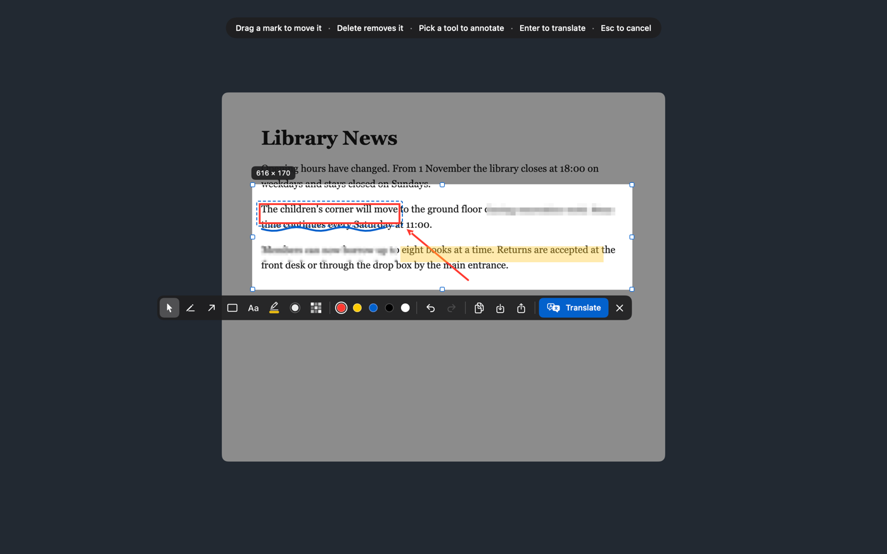
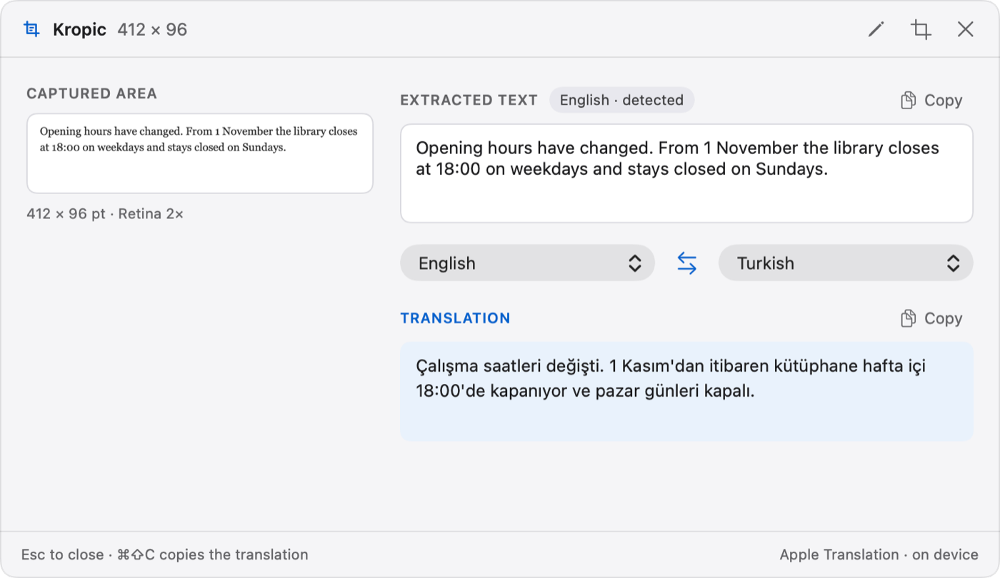
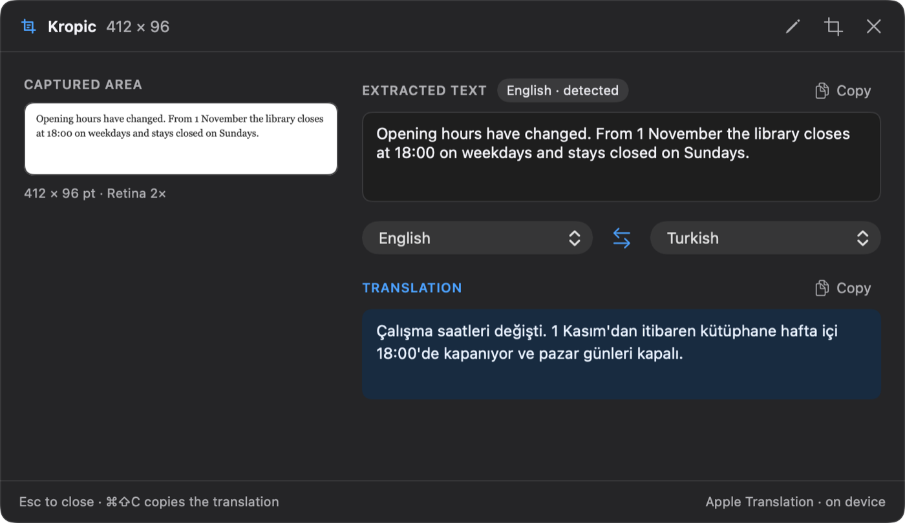
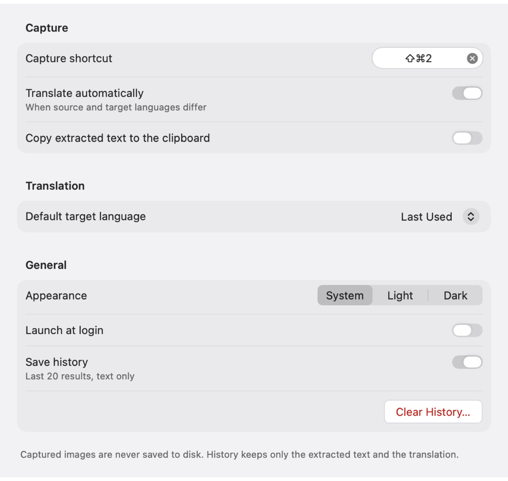

# Kropic

Select any part of your screen, get its text and a translation. Kropic is a small macOS menu bar app for text you cannot copy: in images, videos, locked PDFs, screenshots or apps that block selection. It can also annotate, blur and share the area you selected.

Everything runs on your Mac. Text recognition (Vision) and translation (Apple Translation) are on-device, and Kropic itself makes no network requests.



| Result panel, light | Result panel, dark |
|---|---|
|  |  |

## Features

- **Capture text anywhere.** Press ⌘⇧2 (configurable), drag over the text, press Enter
- **Translate on device.** The source language is detected automatically, the target is remembered, and editing the text re-translates
- **Annotate before you act.** Pencil, arrow, rectangle, text, highlighter, blur and pixelate, five colors, undo and redo. Move marks after drawing them
- **Hide sensitive content.** Blur and pixelate show their real effect while you draw, and text under them is never extracted
- **Copy, save or share the image.** Copy to the clipboard, save a PNG where you choose, or use the macOS share menu
- **History.** The last 20 results, text only, from the menu bar
- **Light and dark.** Follows macOS, or pick one in Settings



## Requirements

- macOS 15 or later (the Liquid Glass app icon needs macOS 26)
- Xcode 26 or later
- [Homebrew](https://brew.sh), for XcodeGen

## Build and run

Kropic is not on the App Store yet. Build it yourself, it takes about a minute.

```bash
git clone https://github.com/ecsabanci/kropic.git
cd kropic
brew install xcodegen
```

**Install into /Applications** (recommended for everyday use):

```bash
Scripts/install.sh
```

**Or run from Xcode:**

```bash
xcodegen generate
open Kropic.xcodeproj
```

Then press ⌘R. The Xcode project is generated from `project.yml`, so run `xcodegen generate` again after pulling changes.

### Screen recording permission

On first launch Kropic asks for screen recording access, because reading text from the screen counts as screen recording on macOS. Turn Kropic on in **System Settings → Privacy & Security → Screen & System Audio Recording**, then restart Kropic (the onboarding window has a button for that).

### Optional: sign with your Apple ID

Without any setup Xcode signs Kropic "to run locally". That works, but macOS may ask for the screen recording permission again after every rebuild. To avoid that, sign with your own Apple ID; a free account is enough:

1. Add your Apple ID in Xcode → Settings → Accounts
2. Copy `Configs/Local.example.xcconfig` to `Configs/Local.xcconfig`
3. Set `DEVELOPMENT_TEAM` to your team ID (shown in Xcode → Settings → Accounts)

`Local.xcconfig` is git-ignored, so your team ID never ends up in a commit.

## Keyboard shortcuts

| Where | Keys |
|---|---|
| Anywhere | ⌘⇧2 capture (change it in Settings) |
| Capture screen | Enter translate · Esc cancel · ⌘C copy image · ⌘S save image · ⌘Z / ⇧⌘Z undo / redo |
| Capture tools | V move · D pencil · A arrow · R rectangle · T text · H highlighter · B blur · P pixelate · Delete removes the selected mark |
| Result panel | ⌘C copy text · ⌘⇧C copy translation · Esc close |

## Privacy

- Captured images stay in memory. Kropic writes an image to disk only when you choose Save and pick a location
- History keeps text only, and can be turned off or cleared in Settings
- No analytics, no accounts, no network requests from Kropic itself. Apple's Translation may download a language pack when you ask it to

## How it is built

Swift 6, SwiftUI and AppKit, with Apple frameworks only: ScreenCaptureKit, Vision, Translation and NaturalLanguage. The one dependency is [KeyboardShortcuts](https://github.com/sindresorhus/KeyboardShortcuts). Testable logic (geometry, OCR layout, language detection, annotations, history) lives in the `KropicCore` package:

```bash
swift test --package-path Packages/KropicCore
```

Kropic was built phase by phase with [Claude Code](https://claude.com/claude-code). The plan and its history are in the repo: [`docs/ROADMAP.md`](docs/ROADMAP.md) for the phases, [`docs/DECISIONS.md`](docs/DECISIONS.md) for every non-obvious decision and why, [`docs/ARCHITECTURE.md`](docs/ARCHITECTURE.md) for how the parts fit, and [`CLAUDE.md`](CLAUDE.md) for the working rules.

## Feedback

Found a bug or have an idea? [Open an issue](https://github.com/ecsabanci/kropic/issues). Contributions are welcome, see [CONTRIBUTING.md](CONTRIBUTING.md).

## License

MIT, see [LICENSE](LICENSE).
